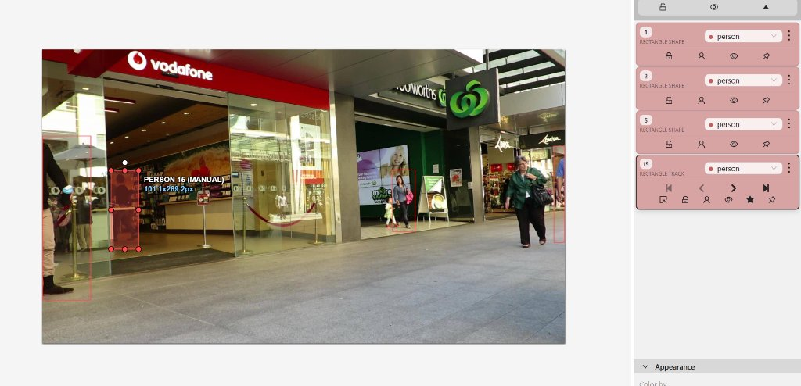
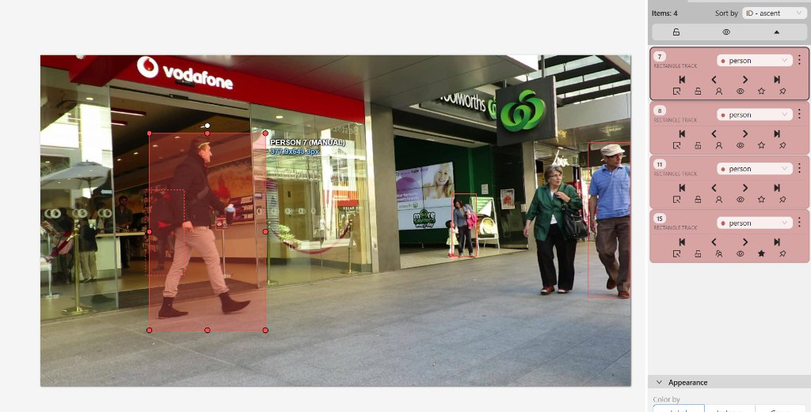
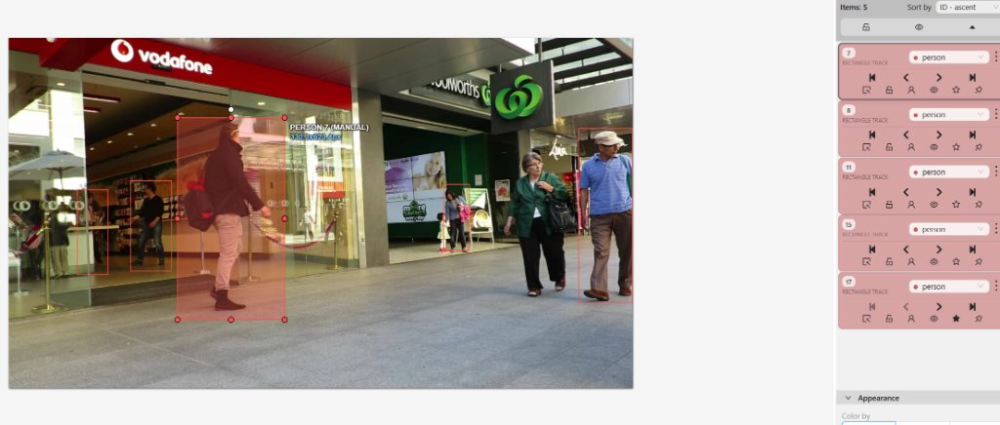

# Báo cáo cá nhân — PhamCongBang-2A202603134

Đoạn video: MOT17-09, 150 frame (frame 1–150), nguồn MOTChallenge, giấy phép CC BY-NC-SA 3.0.

## 0. Thông tin học viên

- Họ tên: Pham Cong Bang
- MSSV: 2A202603134
- Mã đề (A/B/C): C
- Email: pcbang6161@gmail.com
- Link repository: https://github.com/Bangpham006/K5-L2-DAY05-PhamCongBang-2A202603134-MOTTracking
- Giờ bắt đầu: 16:30
- Giờ kết thúc: 00:00

## 1. Xem trước đoạn video (CP0)

Ghi **trước khi vẽ**, mỗi người một dòng.

| Mã | Frame xuất hiện | Frame cuối thấy được | Rẽ / dừng / đổi tốc độ ở frame | Bị che ở frame | Ghi chú |
|---|---:|---:|---|---|---|
| P1 | 0 | 149 | đi chậm, gần như thẳng trong shop Vodafone | 39–55 | áo đen trong shop, bị P5 đi ngang che |
| P2 | 0 | 149 | đứng ở quầy trong shop Vodafone | 32–48 | đứng sau quầy và cửa kính; track hiện gán từ frame 60 |
| P3 | 1 | 149 | đi thẳng đều bên vỉa hè phải | - | tiến lại gần camera nên người to dần |
| P4 | 1 | 106 | đi chậm trước cửa Woolworths | 102–106 | đi cạnh em bé, cẩn thận kẻo vẽ trùm 2 người |
| P5 | 1 | 137 | đi nhanh từ trái sang phải, vắng đoạn 120–128 | 120–128 | bước nhanh, dáng thay đổi nhiều |

## 2. Keyframe và thời gian (CP1, CP4)

Số keyframe lấy từ kết quả `src/check_submission.py`.

| Mã | Số keyframe | Keyframe ở frame | Số frame có mặt | Keyframe / 100 frame | Thời gian (phút) | Chỗ khó |
|---|---:|---|---:|---:|---:|---|
| P1 | 15 | [0, 10, 20, 30, 38, 50, 56, 58, 68, 88, 98, 118, 128, 138, 149] | 139 | 10.8 | | bị P5 che đoạn 39–55 |
| P2 | 10 | [60, 70, 80, 90, 100, 110, 120, 130, 140, 149] | 90 | 11.1 | | đứng sau quầy với kính lóa nên khó nhìn |
| P3 | 19 | [1, 11, 21, 31, 41, 51, 61, 71, 81, 90, 100, 110, 120, 129, 130, 134, 135, 144, 149] | 149 | 12.8 | | đi lại gần camera nên box to dần |
| P4 | 9 | [1, 11, 21, 31, 41, 61, 89, 99, 102] | 106 | 8.5 | | đi sát em bé trước Woolworths |
| P5 | 23 | [1, 7, 11, 21, 31, 41, 51, 61, 71, 81, 90, 100, 110, 114, 115, 116, 118, 119, 129, 133, 135, 136, 137] | 128 | 18.0 | | đi nhanh, sải chân đổi liên tục và vắng đoạn 120–128 |
| **Tổng** | 76 | | 612 | 12.4 | | |

Keyframe / 100 frame của cả bài = tổng keyframe ÷ tổng số frame có mặt × 100 = 76 ÷ 612 × 100 = 12.4

Bạn đặt keyframe nhiều nhất ở người nào? Vì sao (người đó rẽ, dừng, lại gần camera hay bị che)?

đặt nhiều nhất ở P5 (23 keyframe) vì người này đi nhanh ngang qua trước camera, sải chân với bề ngang box đổi liên tục nên phải chỉnh nhiều keyframe, thêm đoạn vắng 120–128 nữa.

## 3. Đoạn bị che (CP2)

Người bị che: `P1`

| Mốc | Frame |
|---|---:|
| Bắt đầu bị che một phần (bật `occluded`) | 50 (lúc mới ló lại sau ba lô P5) |
| Mất hẳn (bật `outside`) | 39 |
| Hiện lại (tắt `outside`) | 50 |
| Thấy rõ trở lại (tắt `occluded`) | 56 |

- Thời gian khuất hẳn: 11 frame = 0.37 giây.
- Quyết định: giữ cùng ID.
- Lý do (trả lời 3 câu: khuất bao lâu so với 60 frame, ngoại hình có khớp, chỗ hiện lại có đúng hướng và tốc độ):

khuất hẳn 11 frame, ngắn hơn nhiều so với ngưỡng 60 frame (2 giây). lúc hiện lại ở frame 50 vẫn là anh mặc áo len đen quần tối trong shop Vodafone, đi tiếp sang phải cùng hướng và tốc độ chậm như cũ nên giữ cùng một ID.

Ảnh chụp màn hình:





## 4. Tự review ID (CP3)

Lượt 1 theo người (đi ngược từ frame 149 về 0 trên CVAT), lượt 2 theo cảnh (nhảy 10 frame). Ít nhất 3 dòng; không có lỗi thì ghi một dòng "đã kiểm hai lượt, không lỗi".

Loại lỗi dùng đúng một trong 7 mã: `id_switch`, `fragmentation`, `lost`, `merge`, `false_track`, `drift`, `flag`.

| Frame | Mã người | Loại lỗi | Mô tả một câu | Phát hiện ở lượt | Đã sửa? |
|---:|---|---|---|---|---|
| 0–60 | ngoài danh sách | false_track | lúc đầu vẽ nhầm cô mặc áo xanh đậm ở góc phải không có trong đề C | lượt 2 | có |
| 41 | P4 | merge | lúc đầu vẽ box trùm sang cả em bé đứng cạnh trước cửa hàng | lượt 2 | có |
| 0 | P3, P4, P5 | fragmentation | dư box ở frame 0 làm một người bị tách thành 2 ID so với track chính | lượt 2 | có |

Tổng hợp số lỗi theo loại:

| `id_switch` | `fragmentation` | `lost` | `merge` | `false_track` | `drift` | `flag` |
|---:|---:|---:|---:|---:|---:|---:|
| 0 | 1 | 0 | 1 | 1 | 0 | 0 |

Lỗi nào chỉ lượt 2 (theo cảnh) mới thấy, lượt 1 (theo người) không thấy? Vì sao?

lỗi `fragmentation` (dư box ở frame 0): khi soát theo từng track ở lượt 1 dễ không để ý tới frame 0 bị tách riêng, đến lúc rà lại tổng thể ở frame 0 mới thấy đã có box/ID riêng nằm sẵn ở đó.

## 5. File xuất và kết quả tự kiểm (CP4)

| Kiểm tra | Kết quả |
|---|---|
| Tên file MOT 1.1 | `src/exports/PhamCongBang_mot.zip` |
| Tên file CVAT for video 1.1 | `src/exports/PhamCongBang_cvat_video.zip` |
| Số track ID khác nhau trong `gt/gt.txt` (phải là 5) | 5 |
| Frame `outside` không có dòng trong `gt.txt` (đúng / sai) | đúng (track ID 1 vắng ở frame CVAT 39–49, tức frame_id 40–50 trong gt.txt) |
| Job đã completed trên CVAT máy cá nhân | *(chuyển sang completed trên CVAT rồi ghi Đã completed)* |

Dán phần tóm tắt in ra từ `src/check_submission.py`:

```text
=== File MOT 1.1: PhamCongBang_mot.zip ===
  Số track ID: 5   |   Tổng số box: 612
  [OK]        Đúng 5 track ID.

=== File CVAT for video 1.1: PhamCongBang_cvat_video.zip ===
  Tổng: 76 keyframe / 612 frame có mặt = 12.4 keyframe / 100 frame
  [OK]        Đọc được 5 track từ annotations.xml.

=== Tóm tắt ===
  Lỗi: 0   |   Cảnh báo: 0
  Đạt. Dán phần tóm tắt này vào báo cáo mục 5.
```

## 6. Ba câu kết

1. Nếu được gán lại, bạn sẽ đặt keyframe khác ở đâu? Vì sao?

   Sẽ đặt keyframe dày hơn cho P5 ở những lúc bước nhanh và ngay quanh đoạn khuất 120–128, vì khi sải chân dài bề ngang box thay đổi nhanh nên nội suy tuyến tính dễ làm box bị lệch.

2. Có chỗ nào bạn không chắc "cùng ID hay ID mới"? Bạn đã quyết định và ghi chú thế nào?

   Không có chỗ nào phải tách ID mới; đoạn phân vân nhất là lúc P1 bị P5 che khuất hẳn từ frame 39–49, nhưng thời gian khuất chỉ 11 frame (ngắn hơn ngưỡng 60 frame), khi hiện lại ở frame 50 vẫn đúng anh áo đen đi tiếp sang phải cùng tốc độ nên quyết định giữ cùng một ID và đã ghi rõ lý do ở mục 3.

3. Một lỗi ID trong job của bạn (nếu không còn sót, chọn lỗi đã sửa) có thể làm xe tự lái dự đoán sai chuyển động của người đó như thế nào? Lỗi đó ảnh hưởng MOTA hay IDF1 nhiều hơn?

   Lỗi merge (box P4 trùm cả mẹ và em bé) khiến xe tự lái gộp hai người thành một vật thể to và lệch tâm vị trí, dễ bỏ sót em bé hoặc đoán sai hướng khi hai người tách nhau. Lỗi này đánh trực tiếp vào MOTA nhiều hơn (cũng làm giảm IDF1) vì box phình to làm IoU < 0,5 qua nhiều frame, bị tính vừa thiếu người thật (FN) vừa dư box sai (FP).

## Bonus (nếu làm)

### B1 — Hai người đi sát

...

### B2 — So cách đặt keyframe

| Cách đặt | Số keyframe | Frame trôi nhất | Ghi chú |
|---|---:|---:|---|
| Đều mỗi 30 frame | | | |
| Theo chỗ đổi hướng | | | |

...

### B3 — So với tracker có sẵn

| Frame | Mã người | Tracker làm gì | Nhãn của bạn | Giải thích (đoán rồi sửa / ghép IoU / box score thấp / ngoại hình) |
|---:|---|---|---|---|
| | | | | |
| | | | | |

## 7. Tài liệu tham khảo và công cụ AI đã dùng

- bộ dữ liệu MOT17-09 (MOTChallenge, Milan et al., 2016), giấy phép CC BY-NC-SA 3.0.
- cvat community chạy trên máy và script `src/check_submission.py`.
- trợ lý ai chat: dùng để hỏi cách dùng cờ `occluded`/`outside` trên cvat, đối chiếu đề c và giải thích lỗi khi chạy `src/check_submission.py`.
